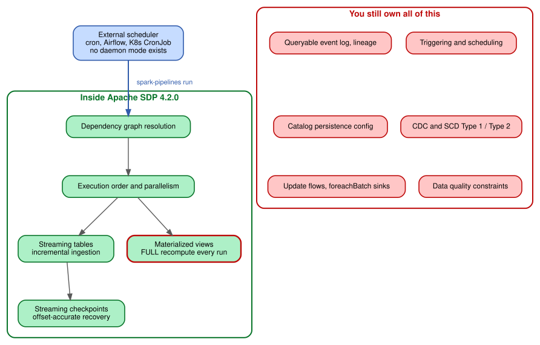
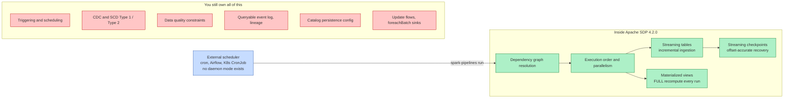
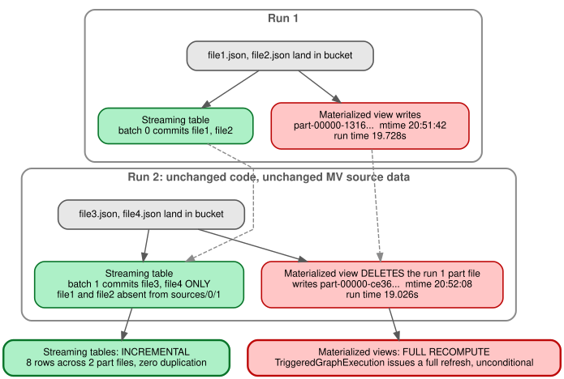
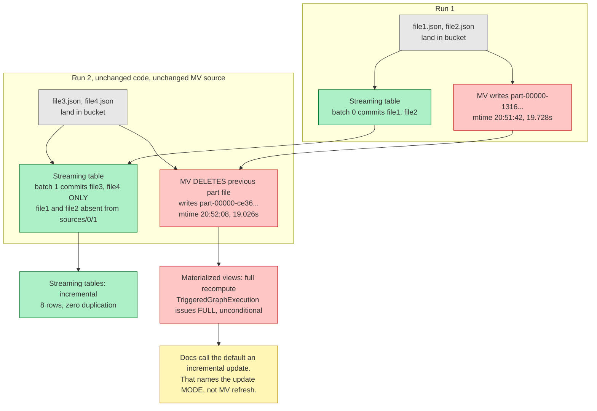
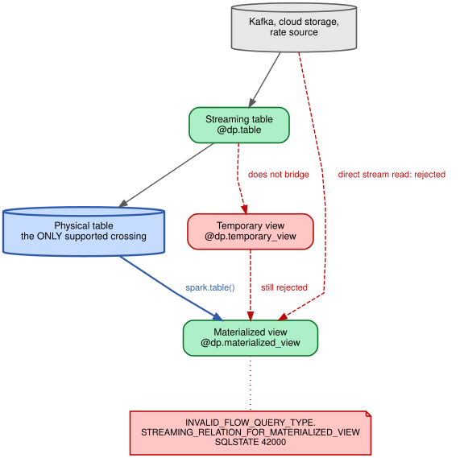
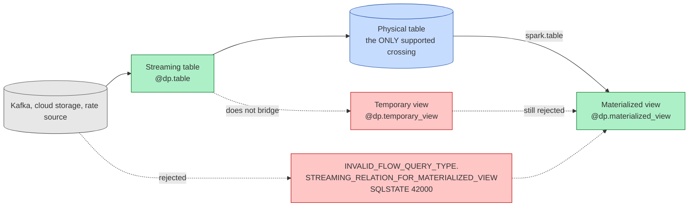

# Spark Declarative Pipelines (SDP) on OCI: Empirical Lab & Findings

An empirical investigation of **Spark Declarative Pipelines (SDP)** on **Apache Spark 4.2.0** running on Oracle Cloud Infrastructure (OCI).

This repository documents the actual operational realities of SDP—benchmarks, bytecode decompilation, failure modes, error states, crash recovery semantics, and object storage integration—grounded entirely in execution telemetry rather than idealized documentation.

* **Interactive Miro Board**: [https://miro.com/app/board/uXjVHpm378I=/](https://miro.com/app/board/uXjVHpm378I=/)
* **Diagram Sources**: Graphviz `.dot`, `.svg`, `.png` in [`findings/diagrams/`](findings/diagrams/)

---

## Key Empirical Findings (What the Spark Docs Don't Tell You)

| Topic | Official Documentation Narrative | Observed Reality on Live Runtime | Finding / Evidence |
| :--- | :--- | :--- | :--- |
| **Repeat Runs** | Pipelines execute incrementally via `spark-pipelines run`. | Standard install crashes on Run 2 with `[LOCATION_ALREADY_EXISTS]` because the default catalog is an ephemeral in-memory session. Static fix `spark.sql.catalogImplementation hive` must be placed in `spark-defaults.conf`, not `spark-pipeline.yml`. | [`findings/01-first-run.md`](findings/01-first-run.md)<br>[`findings/SUMMARY.md`](findings/SUMMARY.md) |
| **Batch MV Staleness** | Materialized views update based on pipeline DAG flow. | Batch materialized views **unconditionally recompute** on every run (`TableRefreshType.FULL`). Every part file is deleted, new UUID part files are written, and mtimes advance even when input data is 100% unchanged. | [`findings/05-verification.md`](findings/05-verification.md) |
| **Streaming Execution** | Streaming tables ingest continuous data streams. | **No continuous daemon mode exists** in open-source Spark 4.2.0. `TriggeredGraphExecution` is the sole concrete implementation and hardcodes `Trigger.AvailableNow()`. Continuous execution is proprietary to Databricks Lakeflow / DLT. | [`findings/05-verification.md`](findings/05-verification.md)<br>[`findings/02-recovery.md`](findings/02-recovery.md) |
| **Crash Recovery** | Resumes from checkpoint metadata. | Hard `SIGKILL` (`kill -9`) terminates without console warning (exit 137). Checkpoint state is strictly preserved; restart resumes exactly from last committed offset with zero row duplication. | [`findings/02-recovery.md`](findings/02-recovery.md) |
| **Stream-to-Batch** | Defines `@dp.table`, `@dp.materialized_view`, and `@dp.temporary_view`. | Hard engine barriers reject mixing stream/batch relations (SQLSTATE `42000`). The **only** valid stream-to-batch architectural bridge is an MV querying the physical storage of a streaming table via `spark.table()`. Temporary views cannot bridge streams. | [`findings/03-flow-type-boundaries.md`](findings/03-flow-type-boundaries.md) |
| **Object Storage (S3A)** | Standard S3A connector configuration. | Hadoop 3.5.0 requires AWS SDK v2 (`bundle-2.35.4.jar`) and `analyticsaccelerator-s3-1.3.1.jar`. Crucially, PySpark installed via pip ignores `$SPARK_HOME/jars`—jars must be placed in PySpark's `site-packages/pyspark/jars/`. | [`findings/04-object-storage.md`](findings/04-object-storage.md) |

---

## Architectural Deep-Dives & Visual Diagrams

The diagrams below summarize the operational boundaries and execution semantics of SDP in Apache Spark 4.2.0.

### Palette Semantic Contract
| Meaning | Fill | Stroke | Interpretation |
| :--- | :--- | :--- | :--- |
| **Measured & Works** | `#adf0c7` | `#087429` | Verified empirically on the live Spark 4.2.0 open build |
| **Absent / Failing Upstream** | `#ffc6c6` | `#bd0909` | Not present upstream, engine error, or architectural omission |
| **Structural Component** | `#c6dcff` | `#305bab` | Physical table, storage, or external trigger mechanism |
| **Source Data** | `#e7e7e7` | `#595959` | Neutral input data stream or file collection |
| **Caveat / Verdict** | `#fff6b6` | `#af7e02` | Empirical verdict, doc-vs-reality tension |

---

### Figure 1: SDP Scope Boundary (What SDP Solves vs. What You Still Own)

In open-source Apache Spark 4.2.0, SDP handles DAG resolution, execution ordering, and checkpoint-backed streaming recovery. However, **no background daemon exists**—execution must be triggered externally (`spark-pipelines run`), and production capabilities like CDC, data quality constraints, and catalog persistence remain your responsibility.


*Source formats: [SVG](findings/diagrams/fig1-sdp-scope-boundary.svg) | [PNG](findings/diagrams/fig1-sdp-scope-boundary.png) | [DOT](findings/diagrams/fig1-sdp-scope-boundary.dot)*



---

### Figure 2: Refresh Behaviour Across Runs (Streaming Tables vs. Materialized Views)

Comparing Run 1 and Run 2 when new files land in object storage while code and batch inputs remain unchanged:
* **Streaming tables** are genuinely incremental: Run 2 reads **only** `file3.json` and `file4.json` (Batch 1), avoiding reprocessing previous files.
* **Materialized views** unconditionally delete their existing part files and recompute everything from scratch via `TableRefreshType.FULL`. The "incremental" label in Spark documentation refers to the pipeline execution mode, **not** batch materialized view refresh.


*Source formats: [SVG](findings/diagrams/fig2-refresh-behaviour-two-runs.svg) | [PNG](findings/diagrams/fig2-refresh-behaviour-two-runs.png) | [DOT](findings/diagrams/fig2-refresh-behaviour-two-runs.dot)*



---

### Figure 3: Stream-to-Batch Architectural Bridge

Probing engine boundaries reveals that Apache Spark strictly forbids reading streaming relations directly inside batch materialized views (`SQLSTATE 42000`). Inserting a temporary view (`@dp.temporary_view`) also fails because temporary views do not materialize data.

The **only** supported mechanism to transition from streaming to batch in SDP is writing to a physical table via `@dp.table` and reading the materialized table via `spark.table()`.


*Source formats: [SVG](findings/diagrams/fig3-stream-to-batch-bridge.svg) | [PNG](findings/diagrams/fig3-stream-to-batch-bridge.png) | [DOT](findings/diagrams/fig3-stream-to-batch-bridge.dot)*



---

## Re-Rendering Diagram Assets

Graphviz `.dot` files in `findings/diagrams/` are the source of truth for publication figures. Re-render them using:

```bash
cd findings/diagrams
dot -Tpng -Gdpi=200 fig1-sdp-scope-boundary.dot -o fig1-sdp-scope-boundary.png
dot -Tsvg              fig1-sdp-scope-boundary.dot -o fig1-sdp-scope-boundary.svg

dot -Tpng -Gdpi=200 fig2-refresh-behaviour-two-runs.dot -o fig2-refresh-behaviour-two-runs.png
dot -Tsvg              fig2-refresh-behaviour-two-runs.dot -o fig2-refresh-behaviour-two-runs.svg

dot -Tpng -Gdpi=200 fig3-stream-to-batch-bridge.dot -o fig3-stream-to-batch-bridge.png
dot -Tsvg              fig3-stream-to-batch-bridge.dot -o fig3-stream-to-batch-bridge.svg
```

---

## Repository Structure

```
├── RUNBOOK.md                 # Step-by-step reproduction contract (zero to fully verified)
├── env/
│   ├── log.sh                 # State-changing command logger for reproducibility
│   ├── provision.sh           # Bare-instance installer (OpenJDK 17, Spark 4.2.0, PySpark)
│   └── versions.lock          # Cryptographically grounded version pin ledger
├── findings/
│   ├── diagrams/              # Architecture figures (Graphviz .dot, .svg, .png, Miro export)
│   ├── 01-first-run.md        # First run & the ephemeral catalog collision
│   ├── 02-recovery.md         # Streaming concurrency, SIGKILL, and offset recovery
│   ├── 03-flow-type-boundaries.md # Engine error matrix across stream/batch/view boundaries
│   ├── 04-object-storage.md   # OCI Object Storage ingestion via S3A connector
│   ├── 05-verification.md     # Pre-publication verification, bytecode audit, & metric proofs
│   ├── README.md              # Index of findings & diagram provenance
│   └── SUMMARY.md             # Consolidated undocumented observations vs. inferences
├── infra/
│   ├── compute.tf             # VM.Standard.E5.Flex compute instance
│   ├── network.tf             # VCN, public subnet, route table, security list
│   ├── storage.tf             # OCI Object Storage bucket (sdp-lab-data)
│   └── terraform.tfvars.example # Sanitized Terraform input template
├── pipelines/
│   ├── hello/                 # Minimal batch materialized view project
│   ├── streaming/             # Mixed DAG: streaming table + batch table + downstream MV
│   ├── boundaries/            # Test suite probing engine flow type boundaries
│   └── object_storage/        # S3A streaming table ingesting from OCI Object Storage
└── runs/
    └── 2026-09-07/
        ├── commands.log       # Raw execution timestamp & exit code ledger
        └── result.md          # Consolidated test execution results
```

---

## Pinned Runtime Stack

Captured directly from the live instance during active execution (see [`env/versions.lock`](env/versions.lock)):

* **Host Architecture**: AMD EPYC Genoa `x86_64` (Ubuntu 22.04.5 LTS, Kernel 5.15.0-1070-oracle)
* **Java Runtime**: OpenJDK `17.0.20+8-Ubuntu-1ubuntu222.04`
* **Apache Spark**: `4.2.0-bin-hadoop3` (Hadoop runtime 3.5.0)
* **Python Runtime**: Python `3.10.12` / PySpark `4.2.0[pipelines]`
* **Object Storage Connectors**: `hadoop-aws-3.5.0.jar`, AWS SDK v2 `bundle-2.35.4.jar`, `analyticsaccelerator-s3-1.3.1.jar`
* **IaC Provider**: Terraform `terraform-provider-oci` `v9.0.0`

> [!NOTE]
> The lab initially targeted OCI Always Free `VM.Standard.A1.Flex` (Ampere Altra ARM64). Region `us-chicago-1` experienced complete ARM host capacity exhaustion across all availability domains, forcing a pivot to `VM.Standard.E5.Flex` (`x86_64`).

---

## Quickstart: Running a Pipeline

### 1. Provision & Install
Follow [`RUNBOOK.md`](RUNBOOK.md) to provision infrastructure with Terraform and run `env/provision.sh` on the target VM.

### 2. Configure Metastore Persistence
To avoid the `[LOCATION_ALREADY_EXISTS]` crash on repeat runs, ensure `/opt/spark/conf/spark-defaults.conf` contains:
```properties
spark.sql.catalogImplementation hive
```

### 3. Execute a Pipeline Project
Every pipeline is defined by a `spark-pipeline.yml` spec file and a transformations directory:

```bash
cd pipelines/hello
spark-pipelines run
```

### 4. Run Object Storage Streaming
Set OCI S3 compatibility properties in `/opt/spark/conf/spark-defaults.conf`:
```properties
spark.hadoop.fs.s3a.endpoint https://<namespace>.compat.objectstorage.<region>.oraclecloud.com
spark.hadoop.fs.s3a.endpoint.region <region>
spark.hadoop.fs.s3a.path.style.access true
spark.hadoop.fs.s3a.connection.ssl.enabled true
```

Export Customer Secret Key credentials in the environment and run:
```bash
export AWS_ACCESS_KEY_ID="<customer-secret-key-id>"
export AWS_SECRET_ACCESS_KEY="<customer-secret-key>"

cd pipelines/object_storage
spark-pipelines run
```

---

## License

Copyright © 2026 Basantra Systems. All rights reserved except as granted below.

This repository is the property of Basantra Systems. It is published so you can read, run, and learn from it. Commercial use is not permitted.

Licensed under the [PolyForm Noncommercial License 1.0.0](LICENSE.md). In short: you may use, copy, and modify it for personal, research, educational, and other noncommercial purposes, and you must keep the notice below. Any commercial use, including using it inside a business, in paid work for a client, or in a product or service, requires a separate written license. To ask about one, email hello@basantra.com.

Required Notice: Copyright Basantra Systems (https://basantra.com)

Write-up: [Spark Declarative Pipelines: What You Own After You Adopt Them](https://basantra.com/insights/spark-declarative-pipelines-what-you-own/)
